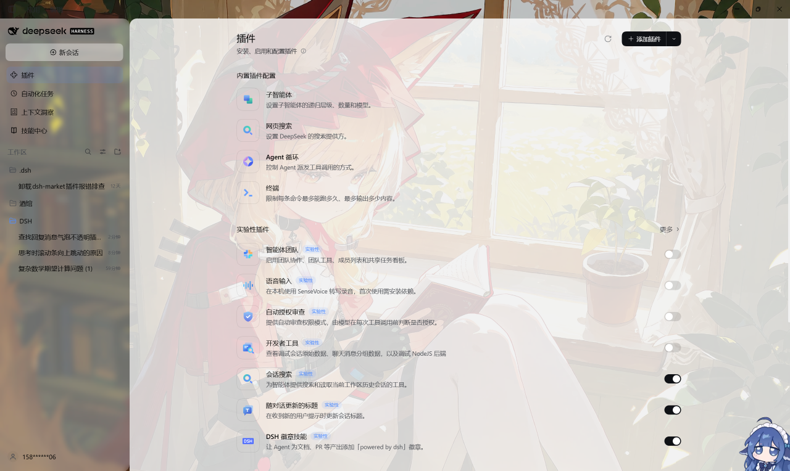
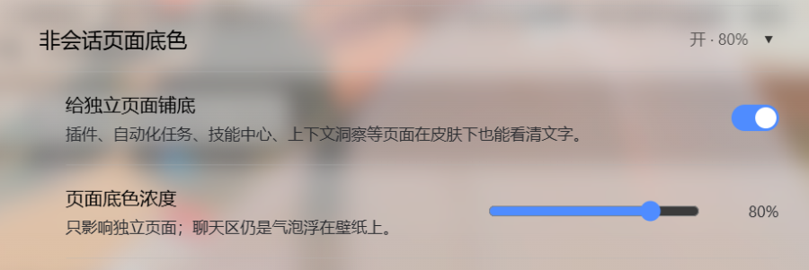

# dsh-assistant-bubble

[](https://awesome-dsh-plugin.com)

使用皮肤插件从wallpaper里导入深色壁纸时，会发现ai回复的文字是无背景的，导致字和壁纸糊在一起无法阅读。所以让大肥鱼单独写了一个小插件实现气泡功能。

这下可以愉快地使用壁纸了。

.

有一些气泡间距的小问题，可能对观感有小影响，但是不太好修，所以就放在那里了，

插件开启前


开启后。气泡透明度之类的可以自己调，单独在设置里开了“助手回复气泡”的分区页。


————以下内容都是肥鱼写的

给 DSH 里**助手回复**加一层自己的气泡底，可选液态玻璃材质；工具条、过程行、统计行等周边信息也能一起同步。

## 为什么需要它

DSH 官方会话界面里，气泡（`..._bubble`）只属于**你发送的消息**；助手回复是一段**没有背景**的正文，
直接压在壁纸上。所以壁纸 / 皮肤类插件的"气泡不透明度""玻璃透明度"都管不到助手回复 ——
深色壁纸下助手的字就看不清了。这个插件补的就是这一块。

## 功能

- **助手回复气泡**：圆角 + 可调底色；可选液态玻璃（白釉高光 + 模糊 + 厚玻璃折射 + 落地阴影）。
- **周边信息同步**：工具条（复制 / 点赞 / 分享 / 用量 / 时间）、过程折叠行、过程分组头（运行中）、
  思考触发条、会话统计行、上下文占用环、运行行 —— 同一份材质、同一组参数，滑块一动一起变。
- **只给"真的有内容"的元素画底**：每个锚点都先核对有没有看得见的文字（≥2 个字）或可见的按钮 / 图标，
  空壳一律不画 —— 所以不会出现"只有底色、没有文字"的空白气泡。
- **「工作步骤展示」明细行**：工具调用行（「运行命令」「网页获取」等）与「思考」行也有气泡 ——
  **折叠**时是紧凑小胶囊、**展开**时保持宿主原本的大横条。
- **非会话页面也有底**：「插件」「自动化任务」「技能中心」「上下文洞察」这些独立页面在皮肤下同样能看清文字 ——
  用一条**通用规则**覆盖所有注册到主内容槽的页面（含第三方），并排除会话槽，所以聊天区仍是"气泡浮在壁纸上"。
  设置页里有一个**可展开的分组**，可以单独开关、单独调浓度。
- **操作条常驻**：取消宿主"非最后一条要悬停才显示"的门控。
- **宽度跟随内容**：气泡不拉满整行。
- **宽表格收进气泡**：宿主原本让宽表格按滚动容器整屏出血，这里改为气泡内横向滚动。
- **无障碍**：系统开启「减少透明度」时自动去掉模糊与白釉。

## 非会话页面

皮肤把 AppFrame 的背景令牌弄透明后，独立页面的文字会直接压在壁纸上。插件用一条通用规则给这些页面的内容根铺底，
并在设置里给了独立开关与浓度：



设置 → 助手回复气泡 → 最下方那个**可折叠分组**（折叠时只有一行字，展开后是开关 + 滑块）：



## 安装

**目前最省事的方式：在 dsh-market（插件市场）里搜 `Assistant bubble` 或作者 `yutianliang`，点一下安装。**

或者直接从 GitHub 装（最新 `main`）：

```bash
# 从 GitHub 安装（最新 main）
dsh plugin --profile web add github:yutianliang/dsh-assistant-bubble
```

官方桌面端也可以走侧边栏 **插件** 页 → 添加插件 → 填 `github:yutianliang/dsh-assistant-bubble`。
本地改代码时用 `link:`：`dsh plugin --profile web add link:E:\path\to\dsh-assistant-bubble`。

卸载：`dsh plugin --profile web remove dsh-assistant-bubble`。

## 设置

安装后，**设置 →「助手回复气泡」**（独立分区，10 个控件）：

| 控件 | 作用 | 默认 |
| --- | --- | --- |
| 液态玻璃 | 白釉高光 + 模糊 + 厚玻璃折射；关掉 = 平实心气泡 | 开 |
| 周边信息同步 | 上面那七处周边信息是否同材质 | 开 |
| 气泡不透明度 | 关闭液态玻璃时的底色浓度 | 60% |
| 玻璃底色浓度 | 玻璃挡下的底色浓度，越高越不透 | 50% |
| 雾化 | 玻璃的模糊半径 | 3px |
| 玻璃颜色 | 6 个预设色块 + 取色器自定义 | #ffffff（深色 #12141a） |
| 白釉强度 | 表面高光与边缘折射强度，0–200% | 100% |
| 深色单独设置 | 打开后深色主题用另一套上面四项 | 关 |
| 非会话页面底色 | 给「插件」「自动化任务」「技能中心」「上下文洞察」等独立页面铺底（可展开分组） | 开 |
| 页面底色浓度 | 独立页面的底色浓度，只影响非会话页面 | 60% |

值保存在浏览器本地 `localStorage["dsh-assistant-bubble:settings"]`（清缓存会回默认值）。

## 兼容性

- **不声明 `engines` / `peerDependencies`**：安装与启用不会被版本检查拦下。
- 客户端半区**不声明** `dsh.client.inject`：模块无条件加载，气泡样式一定生效；
  `slots` / `locale` 两个服务用 `ctx.inject` 运行时等待，拿不到只丢设置页。
- 唯一外部依赖是宿主写在 DOM 上的语义属性与 CSS-Module 类名后缀。宿主大版本更新后最坏的情况是
  **样式静默失效**（看起来像没装），不会报错、不会牵连其它插件。

## 实现要点

所有参数走 CSS 变量，设置页把值内联写到 `body` 上：

```
--dab-solid-alpha   实心气泡底浓度
--dab-glass-alpha   玻璃挡底浓度
--dab-glass-color   玻璃色（r, g, b）
--dab-blur          雾化半径
--dab-sheen         白釉强度倍数
```

玻璃配方对齐 [`dsh-plugin-wallpaper-engine`](https://github.com/elysia395/dsh-wallpaper-engine) 的玻璃面：
白釉渐变 + `blur() saturate(1.3) brightness(1.04)` + 双向内阴影折射 + 落地阴影。

### 思考面板的标题行

展开「思考」时，宿主会给面板内部的**粘性标题行**铺一层实心底色（`--dsw-alias-bg-base`，深色主题下近黑，
展开后就是压在内容上的一条黑带）。这里把它换成**同一颜色的半透明版**并保留吸顶：

```css
background: color-mix(in srgb, var(--dsw-alias-bg-base) 80%, transparent)
```

滚到顶部时仍能遮住下方内容，但不再是一条实心黑条。（不用 `backdrop-filter`：那会把下方的浅色文字
糊成一条白带。）

### 挂在哪些锚点上

| 位置 | 锚点 |
| --- | --- |
| 助手回复正文 | `[data-chat-flow-kind="assistant-step"] div[class*="_root"] > div[class*="_body"]` |
| 工具条（复制 / 点赞 / 用量 / 时间） | `[data-turn-tail] [class*="_actions"]` |
| 过程折叠行「已完成，用时 N 秒」 | `[data-turn-process]` |
| 过程分组头「正在分析请求 · ⋯」 | `[data-process-activity]` |
| 思考触发条 | `[data-turn-trigger]` |
| 工具调用行（运行命令 / 网页获取…） | `[data-tool] [data-disclosure-row]` |
| 「思考」行 | `[data-variant="think"] [data-disclosure-row]` |
| 会话统计行「N 轮 M 步 · tok/s」 | `[data-composer-stats]` |
| 上下文占用环「41%」 | `button[class*="_trigger"]:has(> svg[viewBox="0 0 14 14"])` |
| 运行行「深度求索中⋯」 | `[data-chat-running]` |
| 宽表格 | `.md-table-wide` |

## 开发

实现细节、设计取舍与踩过的坑见 [docs/DEVELOPMENT.md](docs/DEVELOPMENT.md)。

## License

MIT
